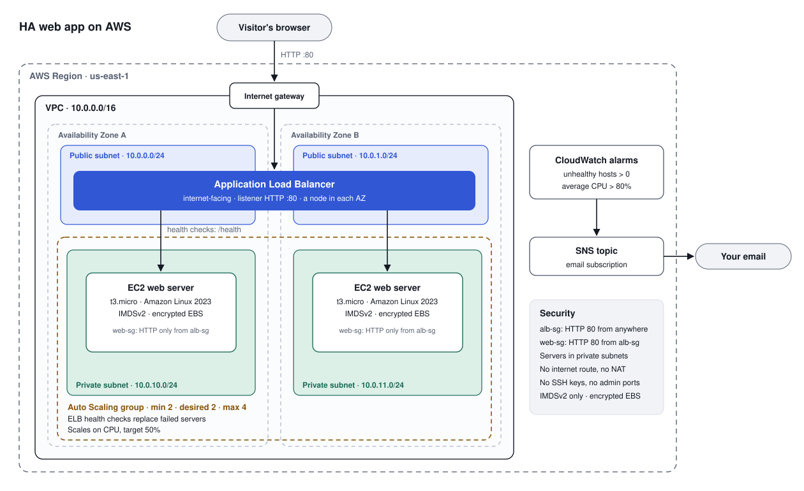

# Highly Available Web App on AWS

An internet-facing **Application Load Balancer** spreads traffic across **EC2 web servers in two Availability Zones**. An **Auto Scaling group** keeps at least two healthy servers running and replaces any server the load balancer marks unhealthy. The whole environment is one **CloudFormation** template, so it deploys in about five minutes and deletes cleanly with one click.

Built as a hands-on project while preparing for the **AWS Certified Solutions Architect – Associate (SAA-C03)** exam.

## What this project shows

| Skill | How it shows up here |
|---|---|
| **High availability** | Two web servers in separate Availability Zones behind one load balancer. Losing an AZ doesn't take the site down. |
| **Self-healing** | The Auto Scaling group uses **ELB health checks**, so a server whose app stops answering gets replaced even though the server itself is still running. |
| **Network segmentation** | Web servers live in **private subnets** with no route to the internet. Only the load balancer is public. |
| **Least-privilege network access** | The servers' security group accepts HTTP **only from the load balancer's security group**, not from an IP range. |
| **Hardened instances** | IMDSv2 required, encrypted EBS volumes, no SSH keys or open admin ports, and the app runs as an unprivileged user. |
| **Elastic scaling** | A target tracking policy keeps average CPU near 50%, between 2 and 4 servers. |
| **Monitoring and alerting** | CloudWatch alarms for unhealthy servers and high CPU send email through SNS. |
| **Cost awareness** | No NAT gateway, small instances, and a one-click teardown. About $0.06 an hour while running. |
| **Infrastructure as code** | Every resource is defined in [`template.yaml`](template.yaml). |

## How a request flows

1. A browser asks DNS for the load balancer's name and gets back the addresses of its nodes, one in each public subnet.
2. The request comes in through the internet gateway to a load balancer node.
3. The listener on port 80 forwards it to the target group.
4. The load balancer picks a **healthy** server in either AZ and sends the request on port 80. The server's security group allows it because it comes from the load balancer's security group.
5. The server answers with a page showing its instance ID and Availability Zone. The page refreshes every 3 seconds, so you can watch requests move between AZs.
6. Every 10 seconds, the load balancer checks `/health` on each server. After 2 failures in a row, it stops sending that server traffic, and Auto Scaling replaces it.

## Design decisions

| Decision | Why | Trade-off |
|---|---|---|
| Web servers in private subnets | Nothing on the internet can reach them directly. | They can't download updates without a NAT gateway or VPC endpoints. |
| No NAT gateway | A NAT gateway costs about $0.045 an hour plus data charges, which is more than the rest of this lab combined. The app needs nothing from the internet. | In production, add one NAT gateway per AZ, or VPC endpoints, so servers can get patches. |
| ELB health checks on the Auto Scaling group | Default EC2 status checks only notice a broken server, not a broken app. | A slow-starting app could be replaced too early, so there's a 120-second grace period. |
| Two AZs, minimum of two servers | The site survives the loss of a whole Availability Zone. | You always pay for two servers. |
| HTTP only (port 80) | A lab doesn't need a domain name or certificate. | In production, add HTTPS with an ACM certificate and redirect HTTP to HTTPS. |
| App built on the Python standard library | It runs on Amazon Linux 2023 with nothing to install, so it works without internet access. | It's a demo page, not a production web framework. |
| IMDSv2 required | Blocks a common way attackers steal instance credentials through the metadata service. | Old tools that only support IMDSv1 won't work. |

## Cost

Approximate on-demand prices in us-east-1 (checked October 2026; see the [EC2](https://aws.amazon.com/ec2/pricing/on-demand/), [Elastic Load Balancing](https://aws.amazon.com/elasticloadbalancing/pricing/), and [VPC](https://aws.amazon.com/vpc/pricing/) pricing pages):

| Resource | Price | While the lab runs |
|---|---|---|
| Application Load Balancer | $0.0225 per hour, plus $0.008 per LCU-hour (tiny for a demo) | about $0.03 per hour |
| Public IPv4 addresses for the load balancer (one per AZ) | $0.005 per hour each | $0.01 per hour |
| 2 × t3.micro instances | about $0.0104 per hour each | about $0.02 per hour |
| 2 × 8 GB gp3 volumes | about $0.08 per GB-month | under $0.01 per hour |
| 2 CloudWatch alarms, 1 SNS topic | about $0.10 per alarm-month; email covered by the SNS free tier | pennies |
| **Total** | | **about $0.06 per hour (about $1.50 a day)** |

A three-hour session costs about $0.20. On a new account's Free plan, usage comes out of your credits. **Delete the stack when you're done.** A budget alert only tells you about spending. It doesn't stop it.

## Deploy

**You need:**
- An AWS account and an IAM user with admin access (not the root user).
- The Region set to **US East (N. Virginia) us-east-1**.
- An EC2 vCPU quota of at least **6** in us-east-1. New accounts can start lower, so check it first.

### Before you deploy: check your EC2 vCPU quota

Each t3.micro uses 2 vCPUs. Two servers run all the time, and when Auto Scaling replaces a failed server, the new one can start launching before the old one is gone. That needs room for 3 servers, or 6 vCPUs. A new account's quota can be as low as 1 vCPU, which can't launch even one server.

1. Open **Service Quotas** in us-east-1, choose **AWS services**, and open **Amazon Elastic Compute Cloud (Amazon EC2)**.
2. Find **Running On-Demand Standard (A, C, D, H, I, M, R, T, Z) instances** and check its applied value.
3. If it's under 6, choose **Request increase at account-level**, enter `6`, and choose **Request**.
4. Track the request on the **Request history** tab. Small increases are often approved automatically. Others become an AWS Support case and can take a few days.

### Create the stack

1. Download [`template.yaml`](template.yaml).
2. Open the **CloudFormation** console and choose **Create stack**, then **With new resources (standard)**.
3. Choose **Upload a template file**, select `template.yaml`, and choose **Next**.
4. Name the stack `ha-web-app` and fill in the parameters:
   - **AlertEmail:** where alarm emails go.
   - **DemoToken:** make up a short password (8–40 letters, numbers, or dashes). It protects the `/fail` demo link.
   - Leave **InstanceType** and **LatestAmiId** as they are.
5. Choose **Next** through the remaining pages, then **Submit**.
6. Wait about five minutes for **CREATE_COMPLETE**. Check your inbox and confirm the SNS subscription email.
7. Open the **Outputs** tab and open the **WebsiteURL**.

## Test it

### 1. Load balancing across two Availability Zones
Open **WebsiteURL** and watch for a few refreshes. The highlighted Availability Zone switches as the load balancer sends each request to a different server.
Screenshots: `02-app-az-a.png`, `03-app-az-b.png`.

### 2. Self-healing with ELB health checks
This simulates the failure that default EC2 status checks miss: the server keeps running, but the app is broken.
1. Open the **FailDemoURL** from Outputs, replacing `YOUR_TOKEN` with your DemoToken. Whichever server answers starts failing its `/health` checks.
2. In the EC2 console, open **Target Groups**, then your target group's **Targets** tab. Within about 20 seconds, one target shows **unhealthy**, and the load balancer stops sending it traffic.
3. Open **Auto Scaling Groups**, then your group's **Activity** tab. Within a few minutes, Auto Scaling terminates the unhealthy server and launches a replacement.
4. Back on the Targets tab, the new server turns **healthy**.

Screenshots: `04-targets-healthy.png`, `05-target-unhealthy.png`, `06-asg-activity.png`.

### 3. Alarm email
During test 2, the **unhealthy hosts** alarm fires and emails you, then sends an OK email after the replacement is healthy.
Screenshot: `07-alarm-email.png`.

### 4. Scale out by hand (optional)
In the Auto Scaling group, choose **Edit** and set **Desired capacity** to 3. A third server launches and starts showing up on the page. Three servers use the full 6-vCPU quota. Set it back to 2 when you're done.

## Results

_Fill this in after you deploy and test. Add your screenshots to [`docs/screenshots`](docs/screenshots)._

| Test | What happened | Evidence |
|---|---|---|
| Load balancing across AZs | | [AZ A](docs/screenshots/02-app-az-a.png) · [AZ B](docs/screenshots/03-app-az-b.png) |
| Self-healing after an app failure | | [Unhealthy](docs/screenshots/05-target-unhealthy.png) · [Activity](docs/screenshots/06-asg-activity.png) |
| Alarm email | | [Email](docs/screenshots/07-alarm-email.png) |
| Clean deletion | | [Deleted](docs/screenshots/08-stack-deleted.png) |

**What I learned:** _Add two or three sentences in your own words._

## Clean up

1. In CloudFormation, select the `ha-web-app` stack and choose **Delete**.
2. Wait for **DELETE_COMPLETE** (about five minutes).
3. Check the EC2 console: no running instances and no load balancers from this project.
4. Check **Billing and Cost Management** the next day.

## Troubleshooting

| What you see | Why | Fix |
|---|---|---|
| The stack sits at **CREATE_IN_PROGRESS** on `WebAutoScalingGroup` for more than 10 minutes. | Auto Scaling can't launch the servers. CloudFormation keeps waiting for the group to reach two servers, then gives up and rolls back, which can take about half an hour. | Don't wait it out. In the EC2 console, open **Auto Scaling Groups**, then your group's **Activity** tab. A failed launch there shows the exact reason within minutes. |
| `WebAutoScalingGroup` fails with *"Group did not stabilize… You have requested more vCPU capacity than your current vCPU limit of 1 allows…"* | The account's EC2 vCPU quota is too low. A t3.micro needs 2 vCPUs. | [Request an increase](#before-you-deploy-check-your-ec2-vcpu-quota). The rollback deletes everything the stack created, so nothing keeps running. Delete the stack in **ROLLBACK_COMPLETE**, wait for approval, then create it again. |
| The review page says **DemoToken** "failed to satisfy constraint." | The token must be 8–40 letters, numbers, or dashes. | Type a new one using only those characters. Typing it avoids hidden spaces that pasting can add. |

## What I'd add next

- **HTTPS:** a domain in Route 53, a certificate from ACM, and an HTTP-to-HTTPS redirect on the load balancer.
- **Patching without public access:** one NAT gateway per AZ, or VPC endpoints, plus Session Manager for shell access without SSH.
- **Edge protection:** AWS WAF on the load balancer, or CloudFront in front of it.
- **Automated deployments:** a GitHub Actions workflow that updates the stack through an IAM role.

## SAA-C03 exam domains covered

| Domain | Topics in this project |
|---|---|
| 1 · Secure architectures | Private subnets, security group chaining, IMDSv2, encrypted EBS |
| 2 · Resilient architectures | Multi-AZ design, ELB health checks, Auto Scaling replacement, service quotas (EC2 vCPU limits) |
| 3 · High-performing architectures | Load balancing, target tracking scaling |
| 4 · Cost-optimized architectures | Skipping the NAT gateway, right-sized instances, teardown |

## Files

| File | What it is |
|---|---|
| [`template.yaml`](template.yaml) | The CloudFormation template. The web app's code is inside the launch template's user data. |
| [`docs/architecture.svg`](docs/architecture.svg) | Architecture diagram (also as [PNG](docs/architecture.png) for slides). |
| [`docs/screenshots/`](docs/screenshots) | Evidence from deploying and testing. |
